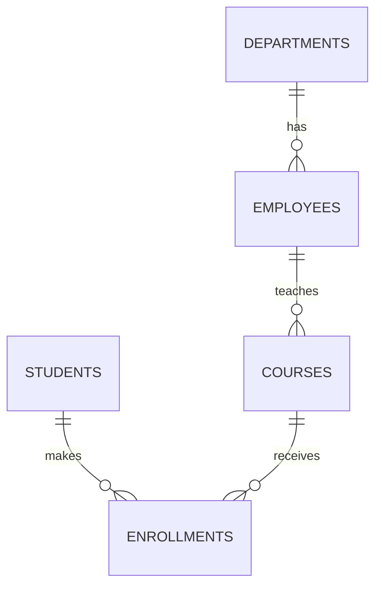

# Database Design

PostgreSQL design for the student / course / employee system
(tasks 121, 122, 123, 124).

| Table | Purpose |
|---|---|
| `departments` | Training, Administration, Student Support |
| `employees` | Staff. `role` is trainer, admin or counsellor |
| `students` | One row per student |
| `courses` | One row per course, linked to its trainer |
| `enrollments` | Which student joined which course (many-to-many) |

## Design decisions
- **Normalized:** each fact is stored once. A trainer's name lives only in `employees`, and courses point to it with `trainer_id`.
- **Foreign keys** keep the data consistent (you cannot enrol a student in a course that does not exist).
- **UNIQUE (student_id, course_id)** stops duplicate enrollments.
- **CHECK constraints** reject bad data (fee below 0, unknown status).
- **ON DELETE rules:** deleting a student also deletes their enrollments; a course with enrollments cannot be deleted; deleting a trainer keeps the course with an empty trainer.
- **Indexes** on foreign key columns make JOINs faster.

## How to run
1. Create a database named `student_db`.
2. Run `db/schema.sql`, then `db/seed.sql`, then try `db/queries.sql`.
